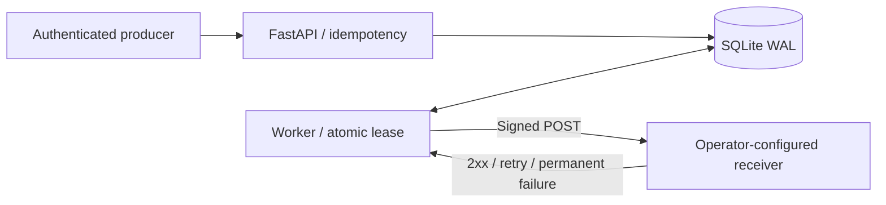

# Relay Ledger

[](https://github.com/nazek52/relay-ledger/actions/workflows/ci.yml)

A durable webhook queue that survives worker crashes and makes delivery history inspectable. Send the same idempotency key twice: receive the same delivery. Reuse it with different content: receive **409 Conflict**.

**Python · FastAPI · SQLite WAL · concurrency · HMAC · Docker**

[Русский разбор](docs/INTERVIEW.ru.md) · [Architecture / guarantees](docs/architecture.md) · [Runbook](docs/runbook.md) · [Verification](docs/verification.md)

## Behavior

- Canonical JSON plus a unique key protects enqueueing against duplicates, including concurrent requests.
- Atomic claims, expiring leases, and fencing tokens prevent a stale worker from overwriting a newer worker's result.
- Retry network errors, 408, 429, and 5xx with exponential backoff and jitter; stop after five attempts, including crashes.
- Sign the exact payload bytes with timestamped HMAC-SHA256; never follow redirects.
- Record attempts, status codes, and exception types without storing receiver response bodies.
- Expose bounded listing, per-delivery history, authenticated queue metrics, and readiness.



## End-to-end demo

Requirements: Python 3.13+, Docker Compose v2, Linux containers.

```sh
python scripts/bootstrap.py
docker compose up -d --build --wait
python scripts/smoke.py
```

The smoke script talks to the real API, repeats an idempotent request, and verifies a signed delivery with attempt statuses **503 → 503 → 200**. Open API docs at <http://127.0.0.1:8011/docs>. Read your token from ignored `.env`; never commit it. Demo receiver statistics are at <http://127.0.0.1:8090/>. API methods use `Authorization: Bearer <RELAY_TOKEN>`.

```json
{"event":"incident.opened","data":{"incident_id":42}}
```

POST this JSON to `/deliveries` with an `Idempotency-Key` header. GET `/deliveries/{id}` for history. GET `/metrics` for queue-state gauges. The API enforces a 32KiB request-body limit, including streamed bodies.

```sh
python -m pip install -r requirements-dev.txt
python -m pytest -q
docker compose down
```

`down` keeps the named SQLite volume. Never use `down -v` unless deliberately discarding the lab data. The subnet defaults to `10.203.43.0/24`; override `LAB_SUBNET` if needed.

## Without Docker

Install requirements, set `RELAY_TOKEN` (16+ characters), `RELAY_SIGNING_SECRET` (32+ characters), `RELAY_TARGET` to a trusted receiver URL, and optionally `RELAY_DB`. Start `uvicorn relay.api:create_app --factory --host 127.0.0.1 --port 8011`; start `python -m relay.worker` in a second terminal with the same configuration. Use random secrets, not example strings.

## Guarantees and boundaries

Delivery is **at least once**, not exactly once. A receiver may complete a side effect before the worker crashes while recording success. Production receivers must deduplicate the delivery ID atomically with their own side effect. The example receiver deduplicates in memory only and is intentionally not restart-safe.

This is a single-host, single-tenant queue. SQLite serializes writes; it is not a multi-host queue. Targets are trusted operator configuration, never user-provided URLs. Production work includes TLS, per-tenant credentials/quotas, egress restrictions, secret rotation, retention, backup/restore policy, and a controlled dead-letter replay procedure. No public exposure is configured.

Personal, AI-assisted engineering project; [MIT](LICENSE).
